## **[CVE-2026-46656]** Improper Authorization and Mediation Failure leading to Persistent Ghost Sessions
* **Discovery Date:** April 25, 2026
* **Software:** Bludit CMS
* **Affected Versions:**  < 3.22.0
* **Patched Versions** : 3.22.0

* **Severity:** HIGH (8.8/10)

---

## 1. EXECUTIVE SUMMARY

Bludit CMS is vulnerable to a critical Broken Access Control flaw where active sessions remain valid even after the corresponding user account has been  physically deleted from the database. This "Ghost Session" allows revoked users to maintain full unauthorized access to the system.

## 2. Impact
_This allows for "Ghost Sessions" where a physically deleted user can still perform actions. A revoked administrator can exploit this persistence to create new administrative accounts, effectively regaining permanent access and bypassing all revocation attempts. This also leads to significant audit inconsistencies, as actions are logged to non-existent entities._

## 3. TECHNICAL ANALYSIS
- **CWE ID:** 
    - CWE-285 (Improper Authorization)
    - CWE-613 (Insufficient Session Expiration)
- **CVSS 3.1 Vector:** `CVSS:3.1/AV:N/AC:L/PR:L/UI:N/S:U/C:H/I:H/A:H`
- **Vulnerability Class:** Improper Authorization / Missing Complete Mediation
- **Location:** bl-kernel/users.class.php within the disableUser() function
- **Vulnerability:** The application relies on server-side session state without re-validating the subject's status or existence against the database for subsequent requests.
- **Mechanism:** Once a session is established, the Kernel trusts the $_SESSION global variable. If an account is physically deleted from the database or disabled, the isLogged() function fails to cross-check the current database state. This allows a "Ghost Session" to remain fully authorized, enabling a revoked user to perform high-privilege actions like creating new administrative accounts.

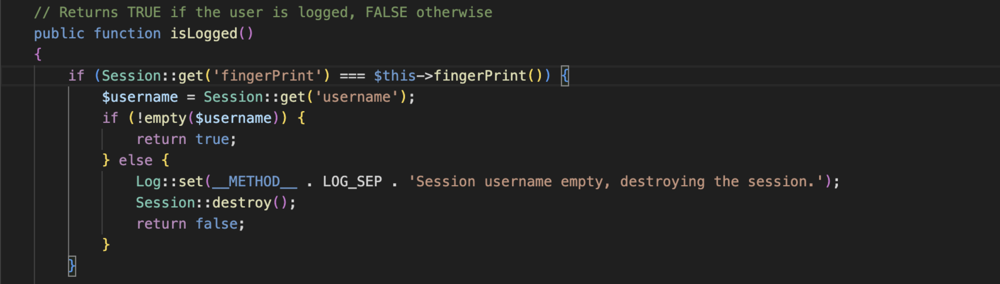

## 4. PROOF OF  CONCEPT 

_Scenario: "The Immortal Administrator" (Backdoor Creation)._

**1.Administrator creates two new users: 'admin2' (Admin role) and 'author' (Author role).**

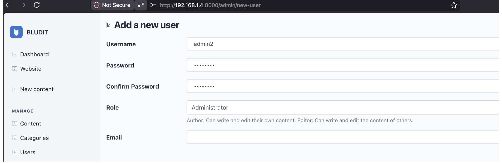
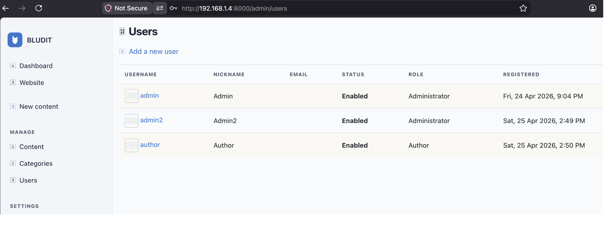

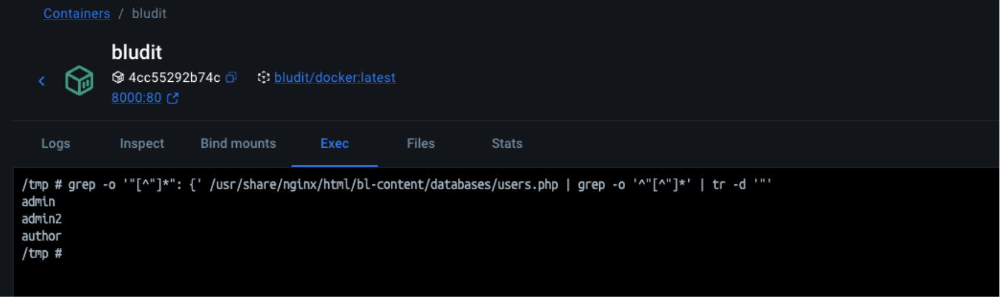

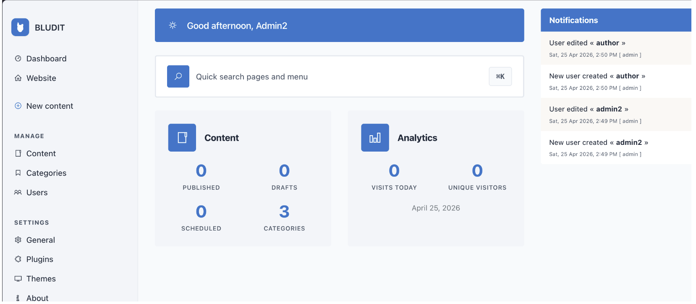
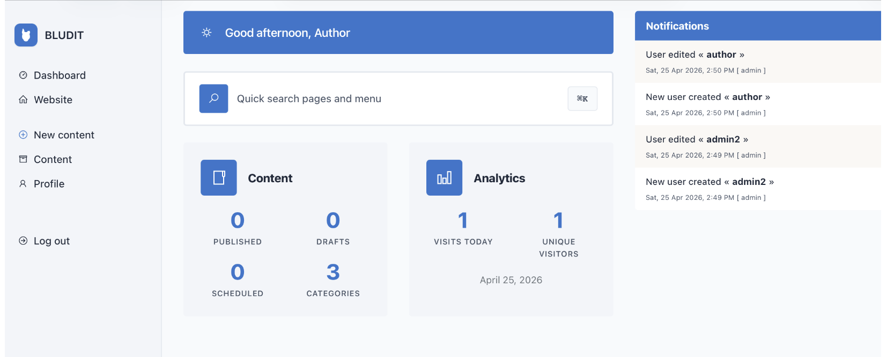

2. **The main administrator proceeds to the deletion of both accounts using the 'Delete user and content' option.**

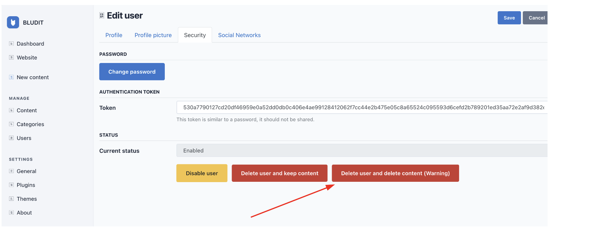

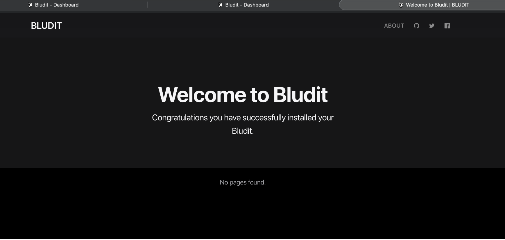

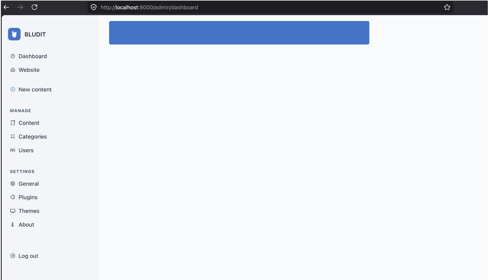

3. **Database Audit: A terminal check confirms that 'admin2' and 'author' entries have been completely removed from the JSON database.**

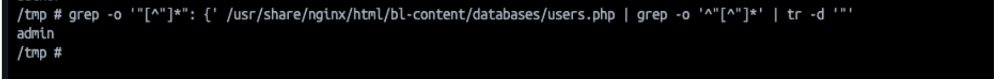
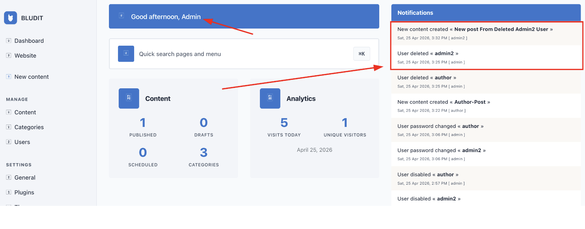

4. **Persistence Test: The deleted 'admin2' user, still using their 'Ghost Session', successfully publishes a new article.**

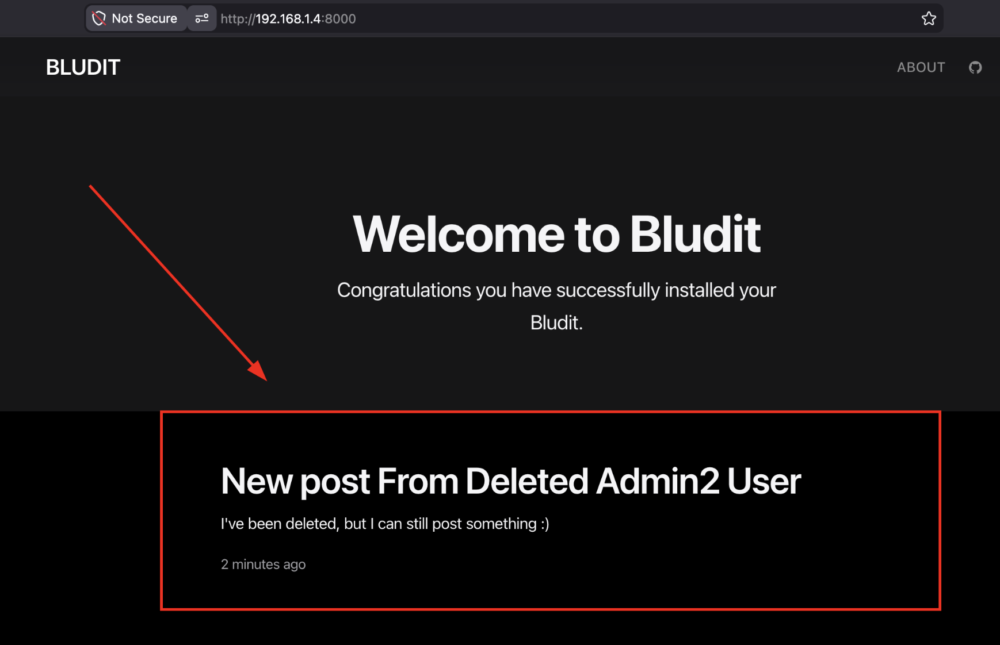
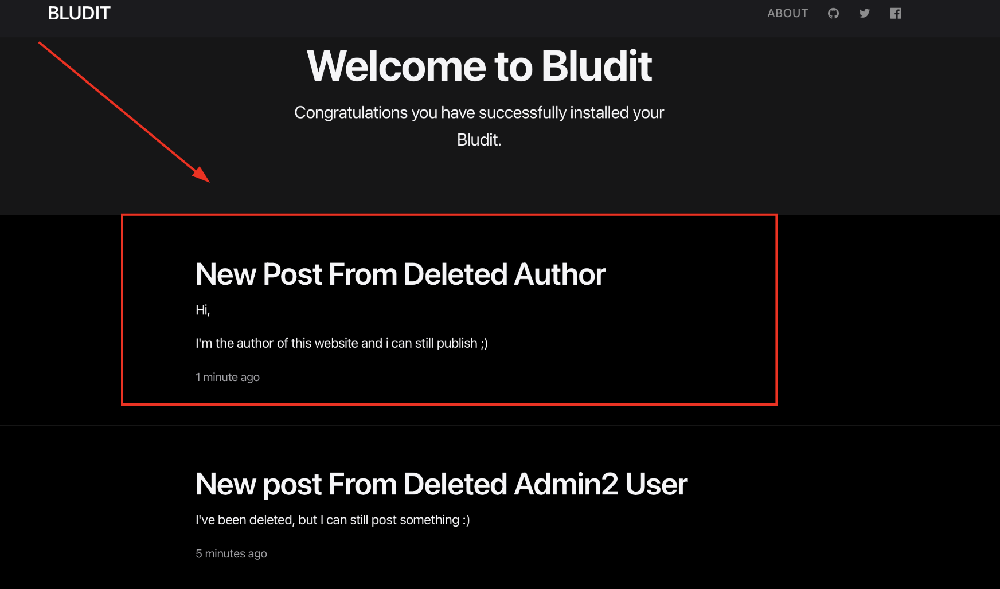

5. **Privilege Escalation: The deleted 'admin2' user accesses the 'Add New User' administrative form.**

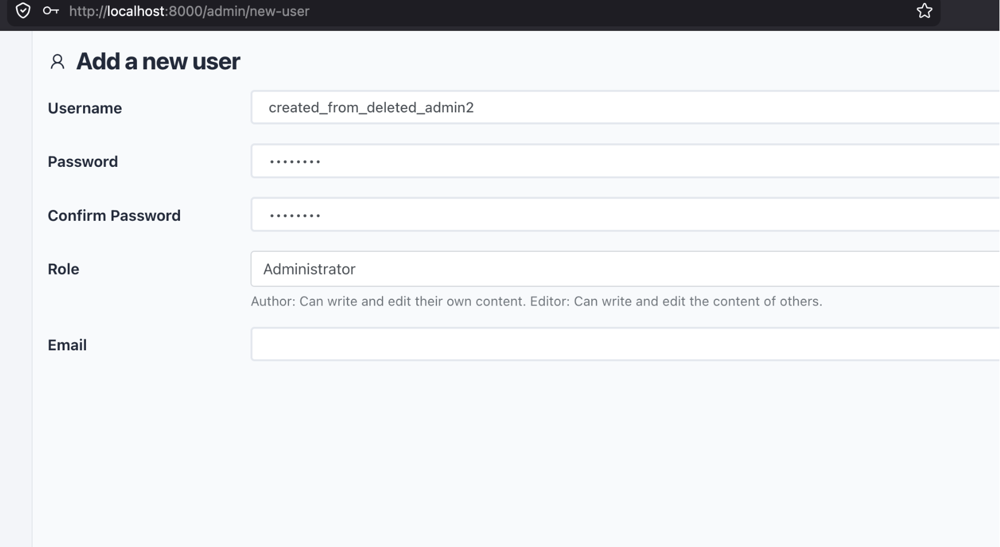

6. **Full Web app compromise: The deleted user creates a new administrator account ('created_from_deleted_admin2'), effectively regaining permanent access to the CMS.**

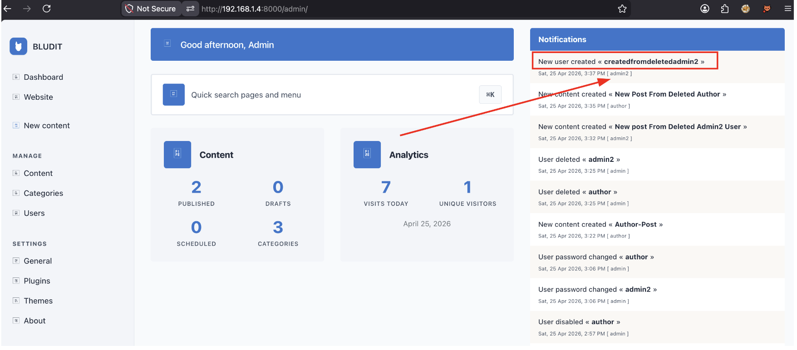
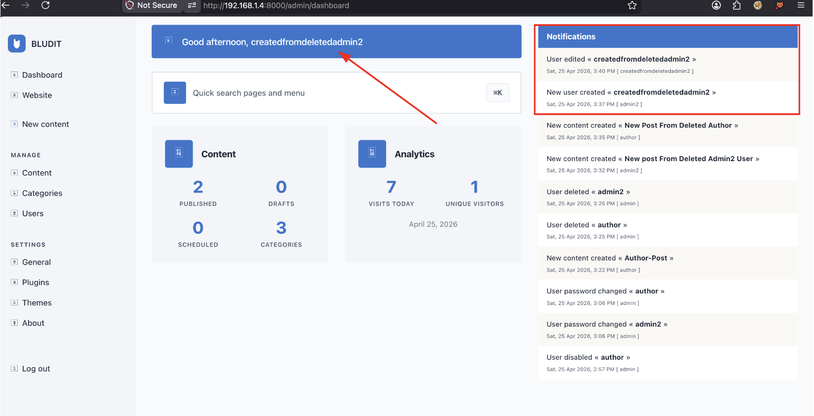
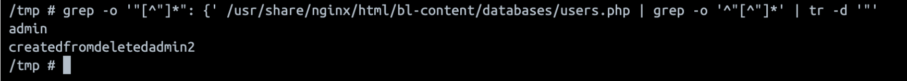

## 5. REMEDIATION

- Update the disableUser() method in bl-kernel/users.class.php to clear the tokenAuth and tokenRemember fields in the JSON database.

### Timeline ⏳

| Date | Event | Status / Reference |
| :--- | :--- | :--- |
| *April 25-27, 2026* | *Initial Discovery*  | Identified session persistence & broken access control vulnerabilities. |
| *April 30, 2026* | *Private Security Disclosure* | Formal report submitted via [GHSA-q42h-wpg8-5wwf](https://github.com/bludit/bludit/security/advisories/GHSA-q42h-wpg8-5wwf). |
| *May 01, 2026* | *Remediation Phase* | Maintainer acknowledged and submitted [PR #1705](https://github.com/bludit/bludit/pull/1705). |
| *May 09, 2026* | *Official Patch Merged*  | Fix integrated into the core ⁠ master ⁠ branch. |
| *May 11, 2026* | *Official Release v3.22.0*  | Public Release including the fix. Credit awarded. |
| *May 13, 2026* | *Advisory Splitting*  | Split into two distinct advisories ([GHSA-rpq2-j9w3-h4jw](https://github.com/bludit/bludit/security/advisories/GHSA-rpq2-j9w3-h4jw) and  [GHSA-ggqg-xvx6-hgwh ](https://github.com/bludit/bludit/security/advisories/GHSA-ggqg-xvx6-hgwh)) to match exact CNA metadata requirements. |
| *May 15, 2026*  | *CVE ID Assignment*  |Officially assigned by GitHub (CVE-2026-46656)|
| *June 08, 2026*  | *Coordinated Public Disclosure*  |Final publication to the global databases.|

### References

- [GHSA-rpq2-j9w3-h4jw](https://github.com/bludit/bludit/security/advisories/GHSA-rpq2-j9w3-h4jw)
- [Commit 7931d1c](https://github.com/bludit/bludit/commit/7931d1c55a3cc535911a9901c328f0197afe1c9f)
- https://www.cve.org/CVERecord?id=CVE-2026-46656
- https://nvd.nist.gov/vuln/detail/CVE-2026-46656
