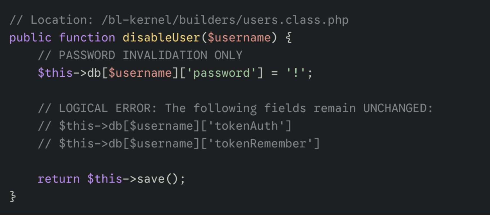
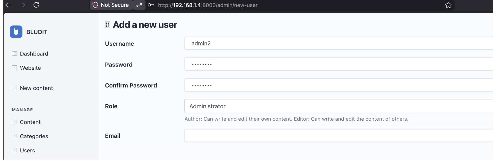
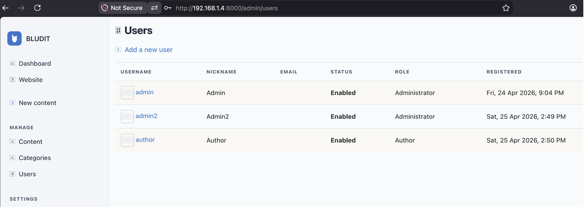
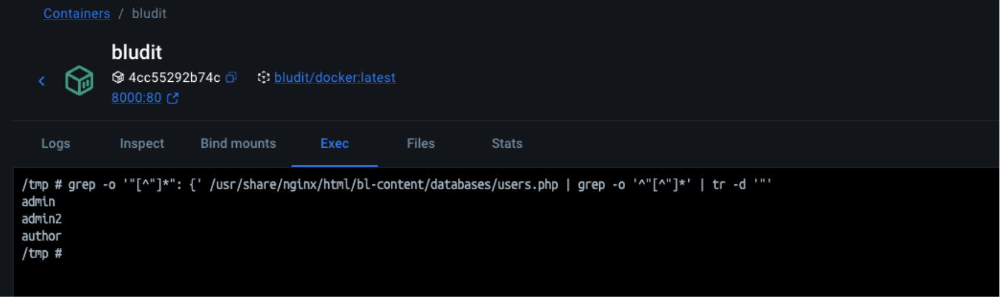
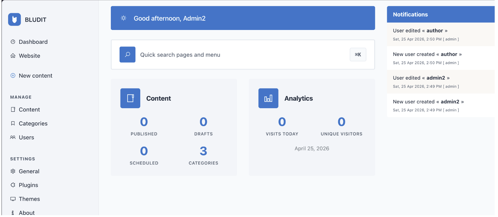
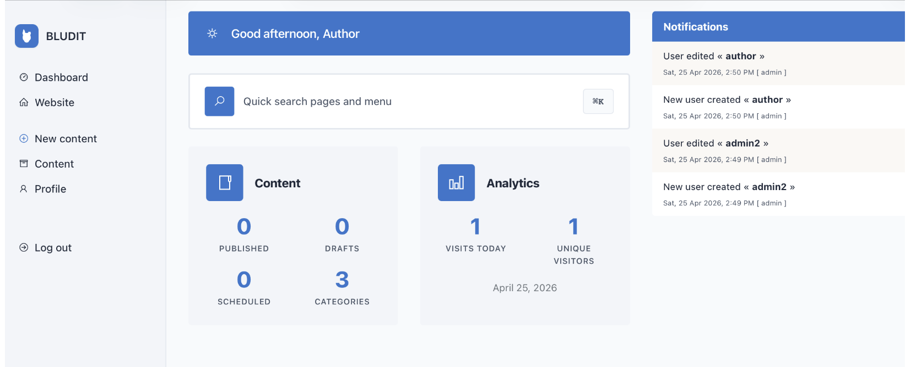
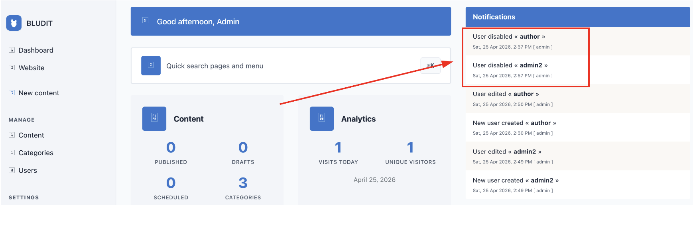
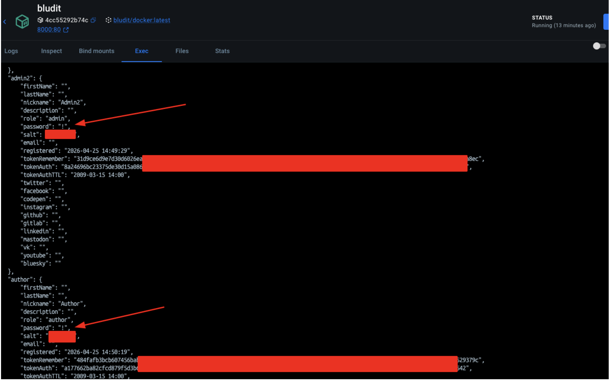
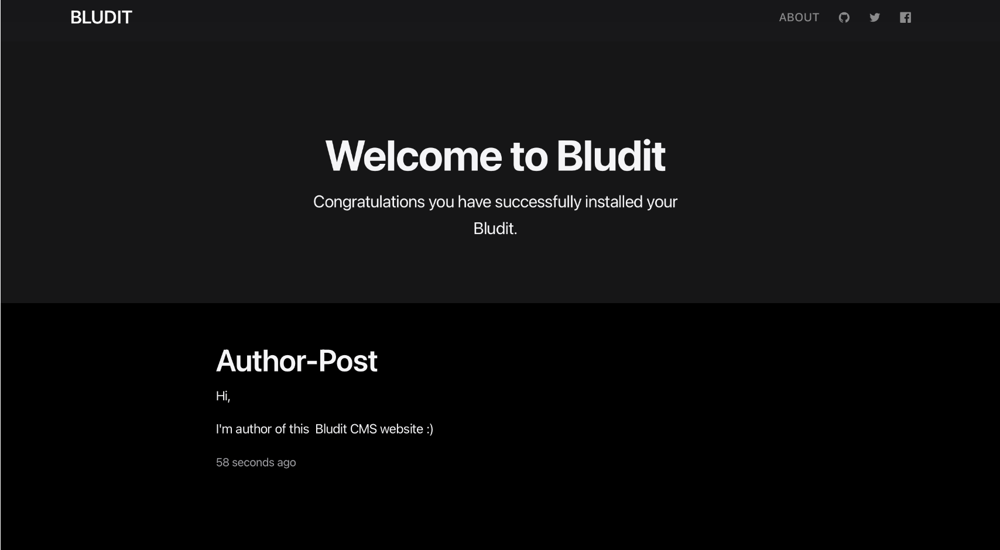
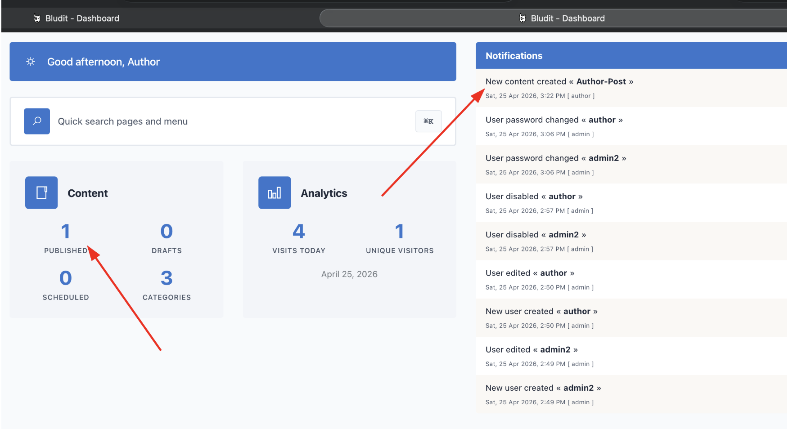

## **[CVE-2026-46657]** Persistent Authentication Tokens not Revoked upon Account Disablement
* **Discovery Date:** April 25, 2026
* **Software:** Bludit CMS
* **Affected Versions:**  < 3.22.0
* **Patched Versions** : 3.22.0

* **Severity:** HIGH (7.1/10)

---

## 1. EXECUTIVE SUMMARY

A vulnerability in the user management logic of Bludit CMS allows deactivated accounts to maintain access via persistent authentication tokens. When an administrator disables a user account, the application fails to invalidate or clear the associated tokenAuth and tokenRemember fields in the JSON database. Consequently, any user with a pre-existing "Remember Me" cookie can bypass the account disablement and maintain a valid authenticated state.

## 2. Impact
_Because these tokens are not cleared, the "Remember Me" functionality continues to recognize the disabled user as authorized. An attacker or a revoked user can bypass the account deactivation by using a valid persistent cookie, maintaining unauthorized access to the application._

## 3. TECHNICAL ANALYSIS
- **CWE ID:** 
    - CWE-613 (Insufficient Session Expiration)
    - CWE-212 (Improper Removal of Sensitive Information Before Storage or Transfer)
- **CVSS 3.1 Vector:** `CVSS:3.1/AV:N/AC:L/PR:L/UI:N/S:U/C:H/I:L/A:N`
- **Vulnerability Class:** Insufficient Session Expiration / Sensitive Data Persistence
- **Location:** bl-kernel/users.class.php within the disableUser() function
- **Vulnerability:** The function correctly marks the password field with a ! to prevent standard login, but it leaves the persistent tokens intact in bl-content/databases/users.php.
- **Mechanism:** Bludit’s "Remember Me" feature validates users by comparing the cookie token directly against the tokenRemember field in the database. Since this field is not cleared when a user is disabled, the authentication sub-system considers the session valid, effectively ignoring the account's "disabled" status.

## 4. PROOF OF  CONCEPT 

**1.Administrator creates two new users: 'admin2' (Admin role) and 'author' (Author role).**

2. **The main administrator disables both 'admin2' and 'author' accounts. The system notifies that the users are now disabled.**

2. **Confirmation in the user management panel that both accounts are active and correctly assigned.**

3. **Technical Verification: Checking the users.php database file. Although passwords are invalidated (marked with '!'), the tokenAuth and tokenRemember remain unchanged.**

4. **The disabled 'author' user successfully publishes a new post titled 'Author-Post', proving that the session is still functional.**

## 5. REMEDIATION

- Update the disableUser() method in bl-kernel/users.class.php to clear the tokenAuth and tokenRemember fields in the JSON database.

### Timeline ⏳

| Date | Event | Status / Reference |
| :--- | :--- | :--- |
| *April 25-27, 2026* | *Initial Discovery*  | Identified session persistence & broken access control vulnerabilities. |
| *April 30, 2026* | *Private Security Disclosure* | Formal report submitted via [GHSA-q42h-wpg8-5wwf](https://github.com/bludit/bludit/security/advisories/GHSA-q42h-wpg8-5wwf). |
| *May 01, 2026* | *Remediation Phase* | Maintainer acknowledged and submitted [PR #1705](https://github.com/bludit/bludit/pull/1705). |
| *May 09, 2026* | *Official Patch Merged*  | Fix integrated into the core ⁠ master ⁠ branch. |
| *May 11, 2026* | *Official Release v3.22.0*  | Public Release including the fix. Credit awarded. |
| *May 13, 2026* | *Advisory Splitting*  | Split into two distinct advisories ([GHSA-rpq2-j9w3-h4jw](https://github.com/bludit/bludit/security/advisories/GHSA-rpq2-j9w3-h4jw) and  [GHSA-ggqg-xvx6-hgwh ](https://github.com/bludit/bludit/security/advisories/GHSA-ggqg-xvx6-hgwh)) to match exact CNA metadata requirements. |
| *May 15, 2026*  | *CVE ID Assignment*  |Officially assigned by GitHub (CVE-2026-46657)|
| *June 08, 2026*  | *Coordinated Public Disclosure*  |Final publication to the global databases.|

### References

- [GHSA-ggqg-xvx6-hgwh ](https://github.com/bludit/bludit/security/advisories/GHSA-ggqg-xvx6-hgwh)
- [Commit 7931d1c](https://github.com/bludit/bludit/pull/1705/changes/60d90b6c84993764eee5f9d54b055c65706556b7)
- https://www.cve.org/CVERecord?id=CVE-2026-46657
- https://nvd.nist.gov/vuln/detail/CVE-2026-46657
