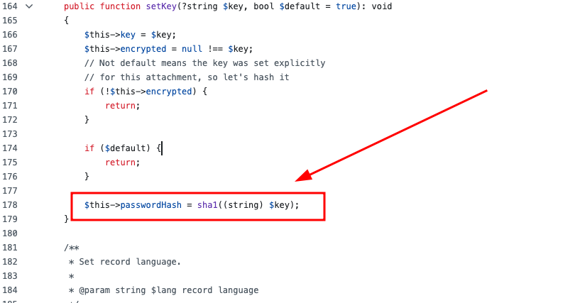

## **[CVE-2026-48488]** Weak Cryptography - SHA1 for Password Hashing
* **Discovery Date:** May 20, 2026
* **Software:** phpMyFAQ
* **Affected Versions:**  <= 4.1.3
* **Patched Versions** : 4.1.4


* **Severity:** LOW 


---

## 1. EXECUTIVE SUMMARY

Attachment passwords are hashed using SHA-1, a cryptographically broken algorithm. SHA-1 has been vulnerable to collision attacks since 2017 (SHAttered).

## 2. Impact
- An attacker can generate SHA-1 collisions to bypass attachment protection.

- Risk of password cracking if database is compromised.

- Estimated cracking time: < 1 minute for standard attachment.

## 3. TECHNICAL ANALYSIS
- **CWE ID:** 
    - CWE-328 (Use of Weak Hash)
- **Location:** phpmyfaq/src/phpMyFAQ/Attachment/AbstractAttachment.php





## 4. REMEDIATION


**Use bcrypt:**

```
public function setPassword(string $password): void
{
    $this->passwordHash = password_hash($password, PASSWORD_BCRYPT);
}

public function verifyPassword(string $plainPassword): bool
{
    return password_verify($plainPassword, $this->passwordHash);
}
```


### Timeline ⏳

| Date | Event | Status / Reference |
| :--- | :--- | :--- |
| *May 20, 2026* | *Initial Discovery*  | Identified Weak Cryptography - SHA1 for Password Hashing |
| *May 20, 2026* | *Private Security Disclosure* | Formal report submitted via [GHSA-58fg-62fg-3fcj](https://github.com/thorsten/phpMyFAQ/security/advisories/GHSA-58fg-62fg-3fcj). |
| *May 21, 2026*  | *CVE ID Assignment*  |Officially assigned by GitHub (CVE-2026-48488)| 
| *May 25, 2026* | *Official Release v4.1.4*  | Published |
| *June 08, 2026*  | *Coordinated Public Disclosure*  |Final publication to the CVE global databases.|


### References

- [GHSA-58fg-62fg-3fcj](https://github.com/thorsten/phpMyFAQ/security/advisories/GHSA-58fg-62fg-3fcj)
- [GHSA-58fg-62fg-3fcj](https://github.com/thorsten/phpMyFAQ/security/advisories/GHSA-58fg-62fg-3fcj)
- https://www.cve.org/CVERecord?id=CVE-2026-48488
- https://nvd.nist.gov/vuln/detail/CVE-2026-48488

